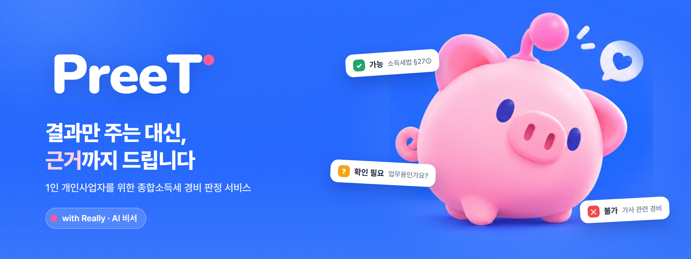

<div align="center">

### 1인 개인사업자를 위한 종합소득세 경비 판정 서비스

> **카드 승인내역만 올리면, 지출 한 건마다 필요경비로 인정되는지 조문 근거와 함께 알려 드립니다.**

**"AI가 규칙을 만들고, 규칙이 판정한다."**

[🌐 서비스 바로가기](https://ktc4-pusan-4.duckdns.org)

---

### 💡 왜 PreeT인가?

|       핵심 가치       | 설명                                                                                   |
| :-------------------: | -------------------------------------------------------------------------------------- |
|   **근거 있는 판정**   | 판정마다 소득세법 조문을 붙여, "왜 되고 왜 안 되는지"를 사용자가 직접 확인할 수 있습니다 |
| **판정 경로에 LLM 없음** | 판정은 결정론적 규칙 엔진이 합니다. 같은 입력이면 언제나 같은 결과가 나옵니다           |
|  **세무사와 함께 쓰는 도구** | 세무사를 대체하지 않습니다. 애매한 건은 확인필요로 남기고, 넘길 자료를 정리해 드립니다    |

---

**개발 기간**: 2026년 9월 ~ 2026년 11월 · 카카오테크 캠퍼스 4기 부산대 4팀

</div>

---

## 목차

<table>
<tr>
<td width="50%">

### 📋 프로젝트 정보

- **[기술 스택](#기술-스택)**
- **[주요 기능](#주요-기능)**
- **[아키텍처](#아키텍처)**
- **[RAG · 코퍼스 동기화](#rag--코퍼스-동기화)**
- **[배포 · CI/CD](#배포--cicd)**

</td>
<td width="50%">

### 🤝 팀이&nbsp;개발한&nbsp;방법

- **[디렉터리 구조](#디렉터리-구조)**
- **[Git 규칙](#git-규칙)**
- **[코드 컨벤션](#코드-컨벤션)**
- **[실행](#실행)**
- **[팀원](#팀원)**

</td>
</tr>
</table>

---

## 기술 스택

| 분류 | 기술 |
| --- | --- |
| **Frontend** |      |
| **Backend** |    |
| **AI** |     |
| **DB** |     |
| **Infra** |     |

---

## 주요 기능

### 1. 카드 내역 업로드 & AI 업종 분류

> **카드 승인내역 업로드**
> KB국민 · IBK기업 카드사에서 받은 승인내역 파일을 그대로 올립니다. 원본 파일은 서버로 보내지 않고 브라우저에서 읽습니다

> **AI 분류 후보**
> 규칙으로 업종을 정하지 못한 가맹점은 AI가 후보를 최대 3개 추천하고, 확정은 사용자가 합니다

<p align="center">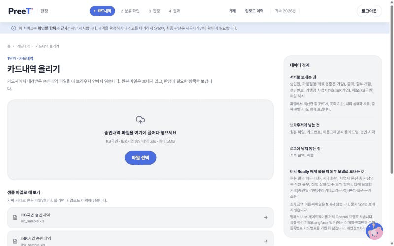</p>

<br/>

### 2. 규칙 엔진 판정 & 되묻기

> **조문 근거와 함께 판정**
> 가능 · 불가 · 확인필요 세 가지로 판정하고, 근거 조문을 붙입니다

> **필요한 것만 되묻기**
> 주말 식대, 자택 겸용 경비처럼 사실 확인이 필요한 건만 짧게 질문합니다

<p align="center">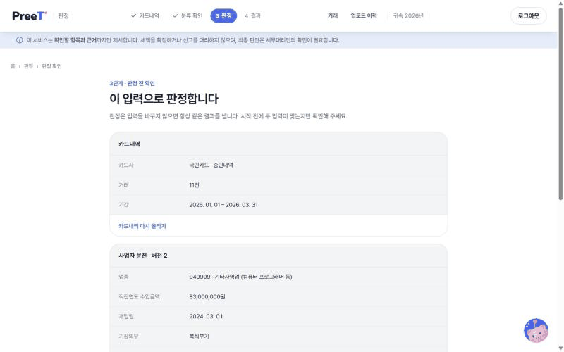</p>

<br/>

### 3. 결과 요약 & 세무사용 내보내기

> **한도·자산 반영**
> 접대비 연 한도 초과액, 100만원 초과 자산의 감가상각까지 반영한 금액을 보여 줍니다

> **CSV 내려받기**
> 세무사에게 그대로 넘길 수 있는 형태로 내보냅니다

<p align="center">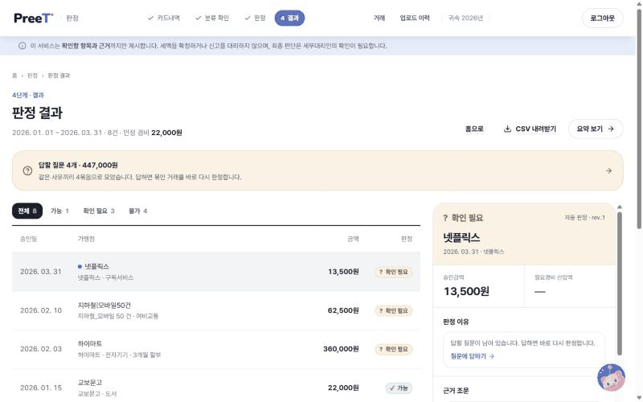</p>

<br/>

### 4. AI 비서 Really

> **판정 결과 설명**
> "이건 왜 안 돼요?" 같은 질문에 내 판정 결과와 조문을 바탕으로 답합니다

> **프롬프트 인젝션 방어**
> 6가지 공격 유형을 직접 시험해 막았습니다 ([보고서](docs/really-prompt-injection-report.md))

<p align="center">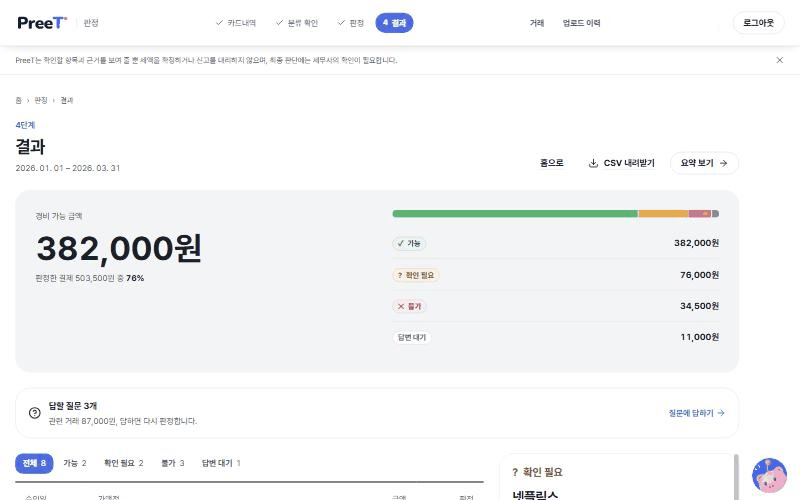</p>

<br/>

### 5. 규칙 후보 자동 승격

> **AI가 규칙 카드 초안 작성 → 관리자 승인 → 자동 PR**
> 승인된 후보를 규칙 카드 파일로 만들어 매주 develop에 PR을 올립니다

<p align="center">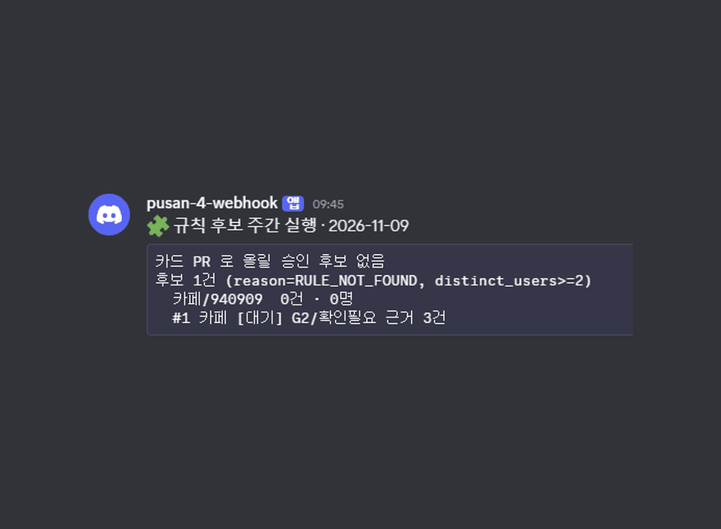</p>
<p align="center">디스코드 후보 알림 → 관리자 화면에서 후보 확인 · 승인 → 주간 배치 알림 → 자동으로 열린 카드 PR</p>

<br/>

---

## 아키텍처

<p align="center">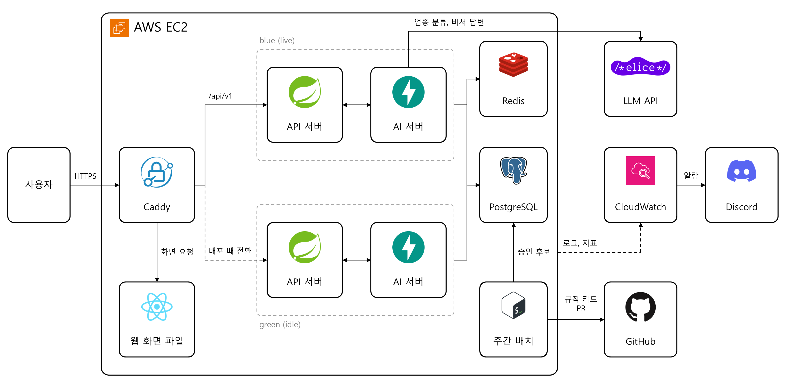</p>

> **판정 흐름**
> 카드내역 → 정규화 → AI 업종 분류(판정 전 단계) → 규칙 엔진 `judge()` → 판정 + 조문 근거

### 구성 요소별 역할

> **Caddy**
> HTTPS를 처리하고, `/api/v1` 요청은 지금 서비스 중인(live) API 서버로, 나머지는 빌드된 웹 화면 파일로 보냅니다

> **API 서버 (Spring Boot)**
> 업로드 · 판정 · 되묻기 · 요약 · 내보내기 API를 제공합니다. 규칙 엔진이 `rules/cards/*.yaml` 규칙 카드로 판정합니다

> **AI 서버 (FastAPI)**
> 규칙으로 업종을 정하지 못한 가맹점의 분류 후보를 추천하고, AI 비서 Really의 답변을 만듭니다

> **PostgreSQL · Redis**
> 거래 · 판정 · 규칙 후보는 PostgreSQL에, 로그인 토큰 · 이메일 인증 · 비서 사용량 제한은 Redis에 둡니다

> **주간 배치 (systemd timer)**
> 관리자가 승인한 규칙 후보를 카드 파일로 바꿔 develop에 PR을 올리고, 결과를 디스코드로 알립니다

> **무중단 배포 (blue · green)**
> API · AI 서버를 두 벌 띄워 두고, 배포할 때 Caddy가 새 버전 쪽으로 요청을 넘깁니다

> **모니터링 (CloudWatch)**
> CloudWatch Agent가 로그와 지표를 모으고, 알람이 울리면 디스코드로 보냅니다

---

## RAG · 코퍼스 동기화

### RAG

<p align="center">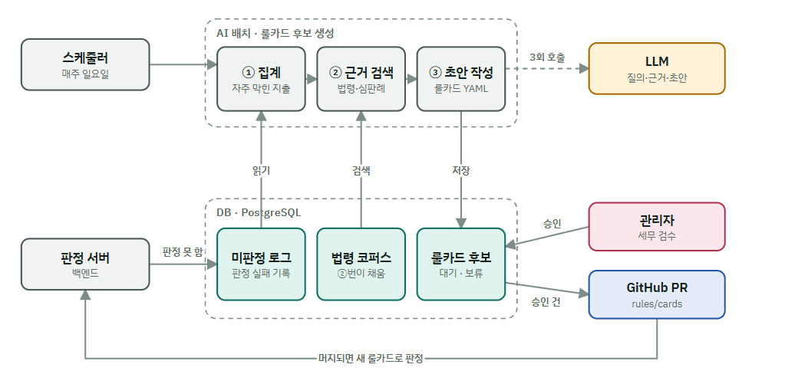</p>

> 하이브리드 검색 기반 RAG로 규칙 카드 자동 생성

### 코퍼스 동기화

<p align="center">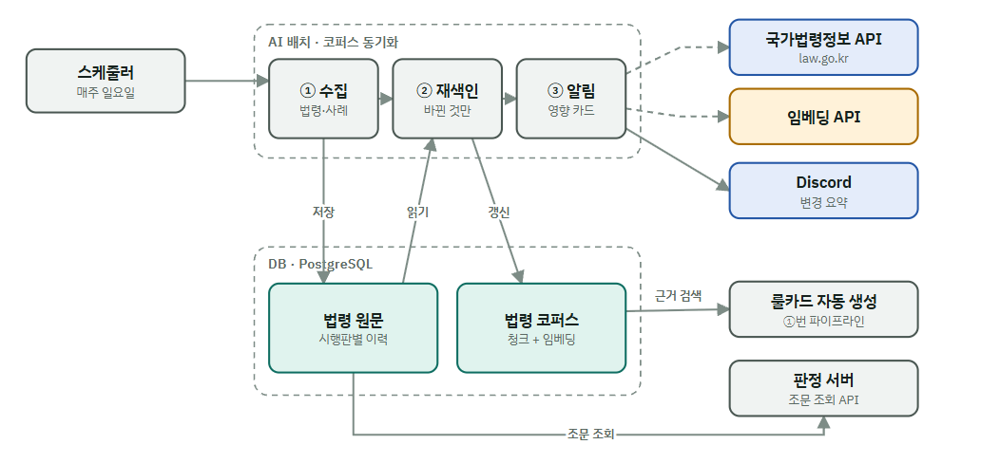</p>

> 매주 국가법령정보 API에서 바뀐 법령만 다시 임베딩해 코퍼스를 최신으로 유지하고, 영향받는 규칙 카드를 알림

---

## 배포 · CI/CD

### CI/CD 파이프라인

<p align="center">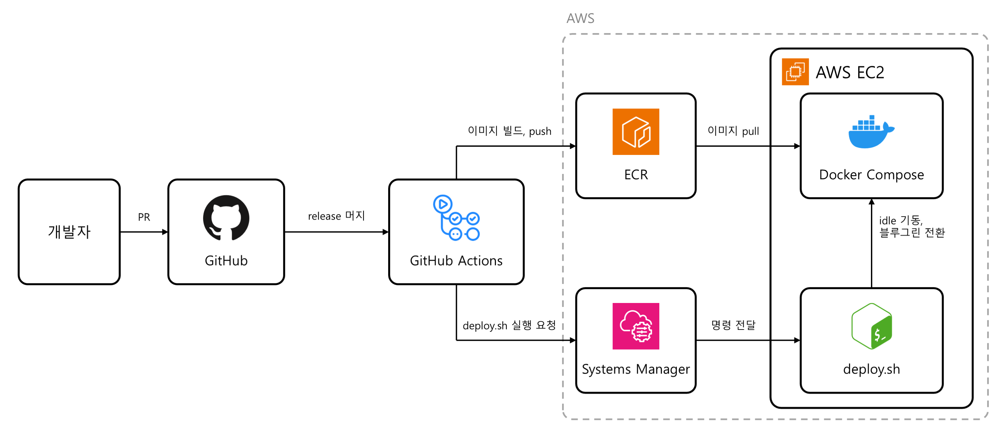</p>

`develop` → `release` PR 이 머지되면 GitHub Actions(`aws-release.yml`)가 자동으로 배포합니다.

1. 백엔드 · AI · 프런트 검증 후 이미지를 빌드해 ECR 에 올립니다
2. SSM 으로 EC2 의 `deploy/deploy.sh` 에 커밋 SHA 를 넘깁니다
3. EC2 가 이미지를 받아 `deploy/compose.yaml` 로 다시 띄우고, 백엔드가 기동하면서 Flyway 마이그레이션을 적용합니다

`release` 로 가는 PR 은 이 레포의 `develop` 에서만 열 수 있습니다. 문제가 생기면 이전 SHA 로 되돌립니다: `sudo bash /opt/ktc4/repo/deploy/deploy.sh <이전 SHA> --rollback`

AWS 준비, 백업, 주간 배치 타이머 설치는 [docs/deployment.md](docs/deployment.md)를 참고하세요.

### Redis (리프레시 토큰 교체)

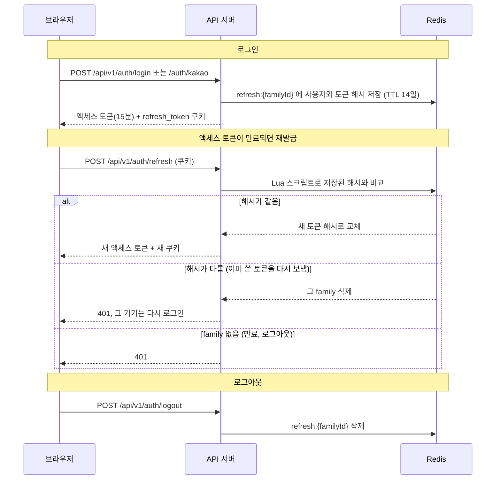

로그인 한 번에 family가 하나 생성되며, 토큰을 해싱해 저장합니다. Lua 스크립트로 토큰 비교와 교체를 구현해 두 요청이 동시에 같은 토큰으로 재발급 받는 상황을 방지했습니다. 이메일 인증 코드, AI 비서 Really의 사용량 한도, 버그 신고 한도도 Redis에 저장되어 있으며, TTL 키를 통해 기한을 관리합니다.

### Blue / Green 배포

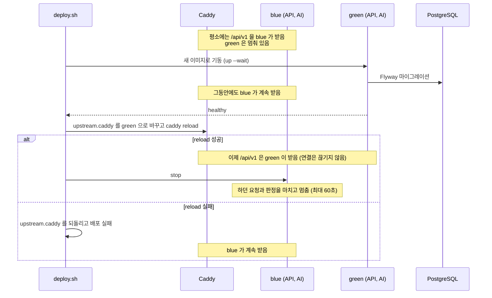

이전 버전과 신규 버전이 혼용되지 않도록 같은 색끼리만 호출하도록 하였습니다. Blue/Green이 같은 DB를 사용하므로 마이그레이션은 직전 릴리스와도 호환되어야 합니다. 배포 시에는 idle인 색을 새 버전으로 교체해 live로 사용합니다.

### 모니터링

#### CloudWatch

<p align="center">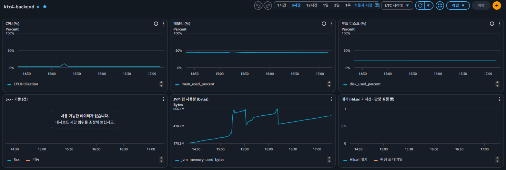</p>

#### Langfuse (AI 에이전트 모니터링)

<p align="center">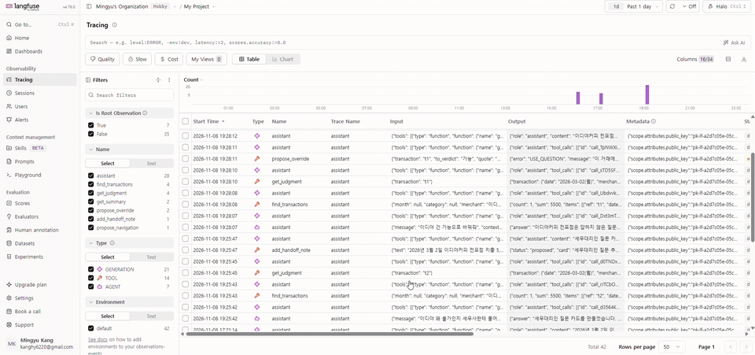</p>

---

## 디렉터리 구조

```
.
├─ frontend/   React + Vite 웹
├─ backend/    Spring Boot API · 규칙 엔진
├─ ai/         FastAPI AI 서버 (업종 분류 · Really)
├─ rules/      규칙 카드 (cards/*.yaml)
├─ eval/       판정 평가셋
├─ deploy/     배포 스크립트 · systemd 타이머
├─ docs/       설계 문서
└─ worklog/    작업 기록
```

---

## Git 규칙

<table>
<tr>
<td width="50%" valign="top">

#### 브랜치

| 브랜치 | 용도 |
| --- | --- |
| `main` | 멘토 리뷰 대상 |
| `develop` | 기본 브랜치 |
| `release` | AWS 자동 배포 |
| `feature/*` | 기능 작업 |
| `refactor/*` | 멘토 리뷰 반영 |

</td>
<td width="50%" valign="top">

#### 커밋 메시지

```
<type>: <subject>
```

```
feat: G6 한도 버킷 판정 추가
fix: 카드사 CSV 헤더 공백 처리
```

전체 type 목록은 [CONTRIBUTING.md](CONTRIBUTING.md)를 참고하세요.

</td>
</tr>
</table>

### Pull Request

<table>
<tr>
<td width="50%" valign="top">

#### 리뷰 규칙

- `feature/*` → `develop` 으로 PR을 올립니다
- 팀원 1명 이상 리뷰 후 PM이 머지합니다
- 매주 `develop` → `main` PR로 멘토 리뷰를 받습니다

</td>
<td width="50%" valign="top">

#### 본문 템플릿

```markdown
## 이번에 한 일
## 리뷰에서 봐주셨으면 하는 곳
## 고민했던 점 · 다른 선택지
## 지난 리뷰 반영 (재리뷰 요청일 때만)
```

</td>
</tr>
</table>

---

## 코드 컨벤션

| 파트 | 도구 | 역할 |
| --- | --- | --- |
| **Frontend** | ESLint | 코드 린팅 |
| **Backend** | PMD · CPD | 정적 분석 · 중복 코드 검사 (CI) |
| **AI** | Ruff · pytest | 린팅 · 테스트 (CI) |
| **공통** | worklog pre-push 훅 | 코드를 push 할 때 `worklog/` 작업 기록을 함께 남깁니다 |

---

## 실행

### 빠른 시작

루트 `compose.yaml` 은 PostgreSQL · Redis · AI 서버를 띄웁니다. Backend · Frontend 는 [파트별 실행](#파트별-실행)으로 따로 띄웁니다.

```bash
git clone https://github.com/kakaotechcampus-4/ktc4-pusan-4.git && cd ktc4-pusan-4
cp .env.example .env    # LLM 키는 비워도 서버는 뜹니다
docker compose up -d    # PostgreSQL(15432) · Redis(16379) · AI 서버(8000)
```

> compose 로 띄운 AI 서버에는 `CLASSIFY_*` 가 넘어가지 않아 업종 분류가 503 으로 답합니다. 분류까지 보려면 AI 서버를 아래처럼 직접 띄웁니다

### 환경 변수

로컬과 운영(EC2)은 서로 다른 파일을 읽습니다.

| | 로컬 | 운영 (EC2) |
| --- | --- | --- |
| 예시 파일 | `.env.example` | `deploy/production.env.example` |
| 실제 파일 | 루트 `.env` | `/etc/ktc4/production.env` |
| 읽는 쪽 | 루트 compose(PostgreSQL · Redis · AI), 직접 실행한 AI 서버 | `deploy/deploy.sh` 가 `deploy/compose.yaml` 에 값을 넘겨 모든 컨테이너에서 사용 |

로컬 compose 는 `.env` 가 비어 있으면 아래 기본값으로 PostgreSQL · Redis 를 실행합니다.

| 환경 변수 | 기본값 |
| --- | --- |
| `DB_NAME` · `DB_USERNAME` | `ktc4` |
| `DB_PASSWORD` | `ktc4-local` |
| `DB_PORT` | `15432` |
| `REDIS_PORT` | `16379` |
| `AI_PORT` | `8000` |

환경 변수를 설정하는 방식은 파트마다 다릅니다.

- **Backend**: 로컬에서 `bootRun` 으로 실행하면 `.env` 를 읽지 않습니다. `application-local.yml` 에 위 표와 같은 DB · Redis 값이 들어 있어 별도 설정 없이 연결됩니다. `.env` 에서 `DB_*` · `REDIS_PORT` 를 바꿨다면 백엔드의 셸 환경 변수나 IDE 실행 설정에도 같은 값을 넣습니다. 운영에서는 compose 가 `production.env` 의 값을 전달합니다
- **AI**: 로컬에서는 루트 `.env` 를, 운영에서는 `production.env` 를 읽습니다
- **Frontend**: 빌드할 때 넘긴 `VITE_*` 만 사용합니다. 로컬에서는 `frontend/.env.local` 에 적거나 실행 명령 앞에 붙입니다. `VITE_API=http` 로 설정하면 목업 대신 실제 API 를 사용합니다. `VITE_API_TARGET` 은 개발 프록시의 대상이며 기본값은 배포 서버입니다. 운영에서는 `deploy/web.Dockerfile` 이 `VITE_API=http` 로 빌드합니다. 카카오 키는 GitHub variable `KAKAO_REST_API_KEY` 로 관리합니다

항목별 설명은 [Backend](#backend), [Frontend](#frontend), [AI](#ai) 절에 정리되어 있습니다. GitHub Actions 의 secret 과 variable 은 [docs/deployment.md](docs/deployment.md) 에서 확인합니다.

### 파트별 실행

#### Backend

JDK 21 과 Docker 만 있으면 됩니다(Gradle 은 wrapper 사용). [빠른 시작](#빠른-시작)으로 PostgreSQL · Redis 를 띄운 뒤 저장소 루트에서 실행합니다.

```bash
bash ./backend/gradlew -p backend bootRun --args='--spring.profiles.active=local'
# 확인: curl localhost:8080/actuator/health · 스웨거: localhost:8080/swagger-ui/index.html
bash ./backend/gradlew -p backend test              # 단위 테스트 (Docker 불필요)
bash ./backend/gradlew -p backend integrationTest   # 통합 테스트 (Testcontainers, Docker 필요)
```

| 환경 변수 | 기능 | 비우면 |
| --- | --- | --- |
| `DB_*` · `REDIS_*` | DB · Redis 접속 | 로컬 compose 기본값(15432 · 16379) |
| `APP_AUTH_EMAIL_DELIVERY` | 가입 메일 인증 | `log` — 인증 코드를 백엔드 로그에 찍음 |
| `APP_AUTH_KAKAO_REST_API_KEY` | 카카오 로그인 | 카카오 로그인 안 됨 |
| `HOLIDAY_API_KEY` | 공휴일 동기화 | 공휴일 거래를 평일로 판정 |

Windows 명령, 테스트 구분, 관리자 계정 만드는 법은 [backend/README.md](backend/README.md)를 참고하세요.

#### Frontend

Node 22 와 npm 만 있으면 됩니다(CI 와 같은 버전). 서버 없이도 돕니다 — 기본은 브라우저 안 목업이라 `npm run dev` 만으로 모든 화면을 볼 수 있습니다.

```bash
cd frontend
npm install
npm run dev                 # http://localhost:5173
VITE_API=http npm run dev   # 목업 대신 실제 API 사용 (기본 대상: 배포 서버)
npm run build               # 프로덕션 빌드. 끝에 공개 페이지를 미리 그린다
npm test && npm run lint    # CI 는 build · test · lint 를 돌린다 (타입: npm run typecheck)
```

| 환경 변수 | 기능 | 비우면 |
| --- | --- | --- |
| `VITE_API` | `http` 면 실제 API, 그 밖에는 브라우저 안 목업 | 목업 |
| `VITE_API_TARGET` | 개발 서버가 `/api/v1/*` 를 넘길 대상 | 배포 서버(`https://ktc4-pusan-4.duckdns.org`) |
| `VITE_KAKAO_REST_API_KEY` | 카카오 로그인 | 카카오 로그인 안 됨 |

폴더 구조, 공용 부품, 검색 노출(prerender) 구조는 [frontend/README.md](frontend/README.md), 색·타이포·문구 규칙은 [frontend/DESIGN.md](frontend/DESIGN.md)를 참고하세요.

#### AI

루트 `.env` 를 읽습니다. 키가 없는 기능은 꺼진 채로 뜹니다.

```bash
cd ai
uv sync
uv run uvicorn app.main:app --reload --port 8000   # 확인: curl localhost:8000/health
uv run ruff check . && uv run pytest               # CI 와 같은 검사
```

| 환경 변수 | 기능 | 비우면 |
| --- | --- | --- |
| `ASSISTANT_*` | AI 비서 Really | 안내 문구로만 답함 |
| `CLASSIFY_*` | 가맹점 업종 분류 | 503 |
| `AGENT_*` · `EMBEDDING_*` · `LAW_API_OC` | 규칙 후보 파이프라인 · 조문 검색 | 배치 실패 |
| `LANGFUSE_*` | LLM 호출 추적 | 꺼짐 |

주간 배치는 직접 돌려 볼 수 있습니다: `uv run python -m pipeline.candidates --dry-run`, `uv run python -m pipeline.promote --dry-run`

---

## 팀원

<table align="center">
  <tr>
    <td align="center"><a href="https://github.com/IwanttobeaHokage"><br/><sub><b>정현빈</b></sub></a><br/>PM</td>
    <td align="center"><a href="https://github.com/yuyeol3"><br/><sub><b>최유렬</b></sub></a><br/>BE 리드</td>
    <td align="center"><a href="https://github.com/RainDrop3"><br/><sub><b>강민규</b></sub></a><br/>AI 리드</td>
    <td align="center"><a href="https://github.com/cho104"><br/><sub><b>이치오</b></sub></a><br/>FE 리드</td>
    <td align="center"><a href="https://github.com/memoryhong"><br/><sub><b>홍성진</b></sub></a><br/>BE · 플래너</td>
    <td align="center"><a href="https://github.com/Jaeseong22"><br/><sub><b>이재성</b></sub></a><br/>FE · 메이커</td>
  </tr>
</table>
