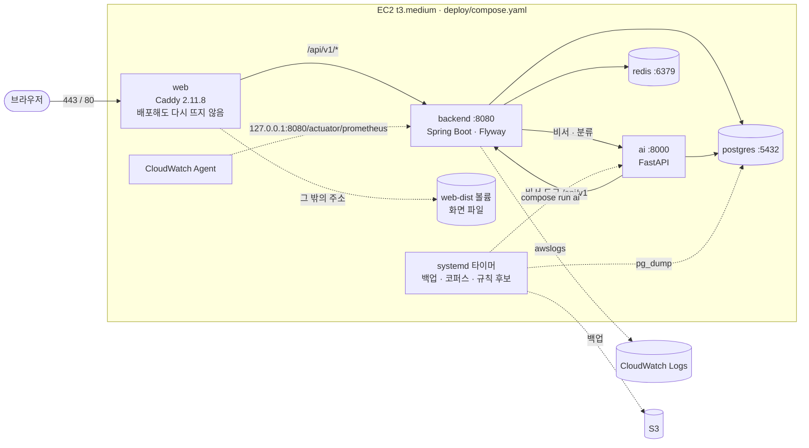
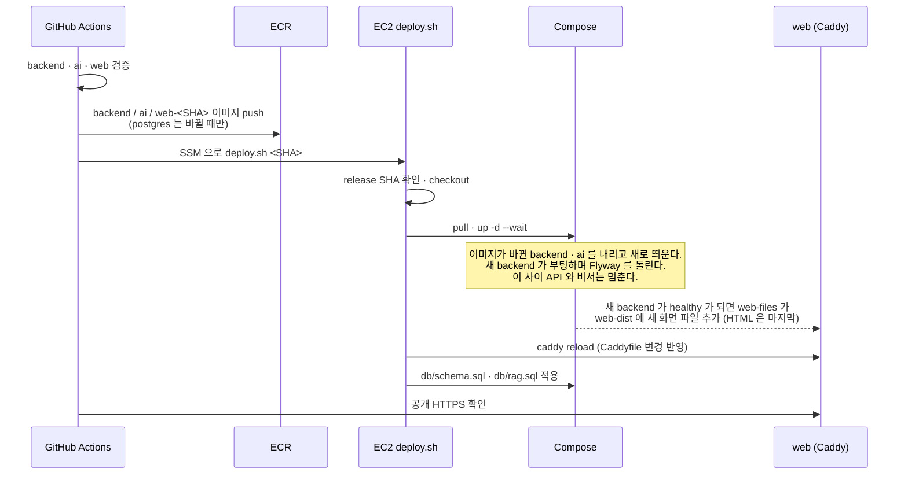

# AWS 배포

카테캠 팀 계정의 Ubuntu 24.04 EC2 한 대에 `deploy/compose.yaml`을 실행한다. 배포 코드는 별도 worktree의 `feat/aws-deploy`에서 작성해 `develop`으로 머지한다. 첫 `release`는 이 설정이 포함된 `develop` 커밋에서 만들고, 이후 `develop → release` PR의 push가 자동 배포를 시작한다. 기존 `develop → main` 멘토 리뷰 흐름은 유지한다.

프런트엔드는 백엔드 API를 HTTP로 호출하고, 백엔드는 목 응답 없이 실제 서비스로 답한다. 로그인은 9절, 배포 뒤 확인은 각 절의 헬스체크를 따른다.

## 구조

### 서버 구성

EC2 한 대에서 Compose 프로젝트 `ktc4`가 컨테이너 다섯 개를 띄운다. 밖으로 열린 포트는 Caddy의 80·443뿐이다.



- 화살표는 호출 방향이다. 점선은 요청 경로 밖의 읽기·배치·수집이다.
- 영속 볼륨은 `postgres-data`, `redis-data`, `caddy-data`(인증서·접근 기록), `caddy-config`, `web-dist`다. 재배포해도 남는다.
- 타이머는 5·6·11절이다. 코퍼스와 규칙 후보 배치는 상시 `ai` 컨테이너가 아니라 같은 이미지로 띄운 일회용 컨테이너에서 돈다.

### 배포 순서

`release` push 한 번이 아래 순서로 흐른다(4절).



## 1. AWS와 DNS 준비

1. 서울(`ap-northeast-2`)의 제공된 EC2에 Elastic IP를 할당·연결한다. DuckDNS에서 서브도메인을 발급하고 A 레코드를 그 EIP로 설정한다. 고정 EIP이므로 DuckDNS 토큰을 GitHub Actions에 등록하지 않는다.
2. EC2 보안그룹 인바운드는 TCP 80·443만 공개한다. 22·5432·8000·8080은 열지 않는다. 인스턴스 접속은 Session Manager를 사용한다.
3. 서울 리전에 비공개 ECR 저장소 `ktc4-pusan-4` 하나를 만든다. 태그는 `backend-<SHA>`, `ai-<SHA>`, `web-<SHA>`, `postgres-<Dockerfile 디렉터리 트리 해시>` 형식이다. 태그 변경 방지를 설정하고 저장소 수명 주기 정책으로 오래된 이미지를 정리한다. 배포 직전 버전은 복구할 수 있도록 최소 7일 보존한다.
4. 비공개 S3 버킷을 만들고 퍼블릭 액세스를 차단한다. `postgres/` 접두사의 객체는 7일 뒤 만료하도록 수명 주기를 설정한다. 백업 스크립트는 SSE-S3 암호화를 지정한다.
5. GitHub Actions의 사전 제공 역할 `ktc-github-deploy`에는 ECR 업로드·조회와 `ssm:SendCommand`, `ssm:GetCommandInvocation`이 필요하다. EC2 인스턴스 역할 `ktc-ec2-ssm-role`에는 ECR 다운로드와 백업 버킷의 `s3:PutObject`·`s3:GetObject`가 필요하다. 권한이 없다면 잠긴 운영진 역할을 수정하지 말고 인프라 매니저에게 필요한 작업과 리소스 범위만 요청한다. 두 역할은 서로 다르다.

AWS는 실행 중인 자동 할당 공인 IPv4와 EIP에 모두 요금을 부과한다. 중지된 인스턴스에 붙은 EIP에도 요금이 계속 붙는다. 비용은 [AWS 공인 IPv4 요금](https://aws.amazon.com/vpc/pricing/)에서 확인한다.

## 2. GitHub 설정

Repository **Settings → Secrets and variables → Actions → Variables**에 다음 값을 등록한다. 계정 ID는 비밀값이 아니다.

| 변수 | 값 |
| --- | --- |
| `AWS_ACCOUNT_ID` | 팀 AWS 계정의 12자리 ID |
| `ECR_REPOSITORY` | `123456789012.dkr.ecr.ap-northeast-2.amazonaws.com/ktc4-pusan-4` 형태의 전체 URI |
| `EC2_INSTANCE_ID` | 제공된 EC2의 `i-...` ID |
| `DOMAIN` | DuckDNS에서 발급한 호스트 이름 |
| `KAKAO_REST_API_KEY` | 카카오 앱의 REST API 키. web 이미지를 빌드할 때 `VITE_KAKAO_REST_API_KEY`로 넘긴다. 브라우저 인가 주소에 실리는 공개 값이다. web 이미지를 `VITE_API=http`로 빌드해야 쓰인다. 그때 비우면 화면에서 카카오 버튼을 숨긴다. 지금 web 이미지는 목업 빌드라 키와 상관없이 목업 카카오 로그인 버튼이 보인다 |

워크플로는 `id-token: write`와 `contents: read`로 OIDC 임시 자격증명을 얻는다. AWS 액세스 키나 SSH 개인키를 GitHub Secrets에 넣지 않는다. `release` 브랜치는 PR 검토를 요구하도록 보호한다. `AWS release`의 `backend`, `ai`, `web` 검증이 통과한 커밋만 승격한다. PR에서는 이 세 검증이 배포와 같은 Dockerfile로 이미지까지 빌드한다(push는 하지 않는다). 레포 구조가 바뀌어 Dockerfile이 깨지면 배포가 아니라 그 PR에서 실패한다. `release`로 가는 PR은 이 레포의 `develop`에서만 연다. `Release source`의 `release-source` 체크가 다른 브랜치나 fork에서 온 PR을 실패시키며, 이 체크도 `release` ruleset의 필수 체크로 등록한다. 이 체크는 `pull_request_target`으로 기본 브랜치(`develop`)에 있는 워크플로 파일을 실행하므로, PR 안에서 파일을 고쳐 통과시킬 수 없다. GitHub은 2025-12-08부터 `pull_request_target`을 base가 아닌 기본 브랜치의 파일로 실행한다([변경 공지](https://github.blog/changelog/2025-11-07-actions-pull_request_target-and-environment-branch-protections-changes/)).

## 3. EC2 최초 준비

Session Manager의 Ubuntu 터미널에서 Docker Engine과 Compose 플러그인을 [Docker의 Ubuntu 24.04 설치 안내](https://docs.docker.com/engine/install/ubuntu/)에 따라 설치한다. AWS CLI v2가 없다면 [AWS 공식 설치 안내](https://docs.aws.amazon.com/cli/latest/userguide/getting-started-install.html)를 따른다. `git`도 설치한다. 배포 스크립트는 SSM Run Command의 root 계정으로 실행되므로 `ubuntu`를 `docker` 그룹에 넣을 필요가 없다.

```bash
sudo mkdir -p /opt/ktc4 /etc/ktc4
sudo git clone https://github.com/kakaotechcampus-4/ktc4-pusan-4.git /opt/ktc4/repo
sudo cp /opt/ktc4/repo/deploy/production.env.example /etc/ktc4/production.env
sudo chmod 600 /etc/ktc4/production.env
sudoedit /etc/ktc4/production.env
```

환경 파일에 실제 ECR URI, 도메인, S3 버킷을 넣고 `DB_PASSWORD`는 `openssl rand -hex 24`로 생성한다. 이 파일은 Git이나 SSM 명령 인수에 넣지 않는다. `DATABASE_URL`이 비밀번호를 URL에 포함하므로 비밀번호는 예제처럼 영숫자만 사용한다. 외부 API 키는 해당 기능을 쓸 때 이 파일에 추가한다.

```bash
sudo docker compose version
sudo aws sts get-caller-identity
sudo aws ecr get-login-password --region ap-northeast-2 >/dev/null
```

첫 `release` push 전, EC2 인스턴스 역할로 ECR 로그인과 백업 버킷 업로드가 되는지 확인한다. 서버의 ECR URI와 GitHub 변수의 값은 같아야 한다. EIP와 DNS가 연결되고 80·443 인바운드가 열려 있어야 Caddy가 인증서를 발급할 수 있다.

## 4. 배포와 확인

`release` push가 발생하면 `.github/workflows/aws-release.yml`이 백엔드·AI·프런트 검증을 실행하고, GitHub 러너에서 이미지를 빌드해 ECR에 올린다. SSM이 EC2의 `deploy/deploy.sh`에 커밋 SHA를 전달한다. 스크립트는 원격 `release`의 현재 SHA와 일치하는지 확인하고 이미지 pull, Compose 기동, 화면 파일 반영, Flyway 완료 후 `db/schema.sql`과 `db/rag.sql`을 차례로 적용한다. DB 초기화 단계에서는 확장만 설치한다. `postgres-data`와 Caddy 인증서 볼륨은 재배포해도 유지된다.

웹 컨테이너(Caddy)는 배포해도 다시 뜨지 않는다.

- `web-<SHA>` 이미지는 화면 파일만 담는다. Compose `up`이 새 백엔드가 healthy가 된 뒤 이 이미지를 일회성 서비스 `web-files`로 돌려 `web-dist` 볼륨에 파일을 옮긴다(`deploy/web-publish.sh`). 끝난 `web-files` 컨테이너는 `Exited (0)`으로 남는다.
- 옛 파일은 지우지 않는다. 이미 화면을 연 브라우저가 옛 해시 청크(`/assets/*`)를 이어서 받는다. 배포당 수 MB라 따로 정리하지 않는다.
- Caddy는 서버 repo의 `deploy/caddy/`를 그대로 읽고, `deploy.sh`가 매번 `caddy reload`로 Caddyfile 변경을 연결을 끊지 않고 반영한다. 설정이 틀리면 reload가 실패해 배포가 실패하고, Caddy는 옛 설정으로 계속 낸다.
- Caddy 버전(`deploy/compose.yaml`의 `web` 이미지)이나 `web` 서비스 정의를 바꾼 배포에서만 웹 컨테이너가 다시 떠 몇 초 끊긴다.

```bash
sudo cat /opt/ktc4/current-sha
sudo docker ps --filter name=ktc4
curl -I "https://<도메인>/"
```

`docker compose ps`에서 PostgreSQL·Redis·백엔드·AI가 healthy이고 웹 컨테이너가 running이어야 한다. 브라우저에서 `/`, `/upload`를 새로고침해 SPA 라우팅을 확인한다. 백엔드 `/actuator/health`와 AI `/health/db`는 컨테이너 내부 검사로 확인하며 외부에 공개하지 않는다. `docker stats`와 `df -h`로 4GB 메모리·50GB 디스크 사용량을 확인한다.

배포 때 실행되는 `deploy.sh`는 직전 배포의 파일이다. SSM이 스크립트를 띄운 뒤 스크립트가 새 커밋을 checkout해도, bash는 이미 연 옛 파일을 끝까지 실행한다. 그래서 `deploy.sh` 자체의 변경은 그 다음 배포부터 적용된다. 새 커밋의 `compose.yaml`은 같은 배포에 적용되므로, 처음 배포에서 꼭 돌아야 하는 단계는 스크립트가 아니라 Compose 정의에 둔다(`web-files`가 그 예다).

Compose는 기존 백엔드를 내린 뒤 새 백엔드를 띄우고, 새 백엔드가 부팅하면서 Flyway를 실행한다. 마이그레이션이 실패하면 그 시점부터 서비스가 멈추므로 5절의 롤백 명령으로 이전 SHA를 다시 배포한다. 마이그레이션 작성 규칙은 `db/README.md`를 따른다.

기존 백엔드는 내려가기 전에 새 요청을 받지 않고, 돌던 판정 run과 대기열의 run을 최대 60초(`app.judgment-run.await-termination`)까지 마저 처리한다. 그래서 판정이 도는 중에 배포하면 백엔드가 멈춰 있는 시간이 그만큼 길어진다. Compose의 `stop_grace_period`(100초)가 이보다 짧으면 그 전에 강제로 꺼진다. 60초 안에 못 끝낸 run은 새 백엔드의 멈춘 run 정리가 5분 뒤 `RUN_INTERRUPTED`로 끝내고, 사용자가 다시 실행한다.

### PostgreSQL이 다시 시작되는 변경

DB는 평소 배포에서 그대로 유지된다. 아래 변경이 포함된 배포에서만 postgres 컨테이너가 다시 만들어지며, 재시작하는 동안 백엔드와 AI가 DB에 접속하지 못한다. 데이터는 `postgres-data` 볼륨에 남는다. 이런 PR은 본문에 DB 재시작을 적고 리뷰한다.

- `docker/postgres/` 아래 파일. 디렉터리 트리 해시가 이미지 태그라 태그가 바뀐다.
- `deploy/compose.yaml`의 `postgres` 서비스 정의(이미지, 환경 변수, 볼륨, `mem_limit`, healthcheck).
- `/etc/ktc4/production.env`의 `DB_NAME`·`DB_USERNAME`·`DB_PASSWORD`.

다음은 재시작만으로 해결되지 않는다.

- PostgreSQL 메이저 버전(`pgvector/pgvector:pg17`의 `17`)을 올리면 기존 데이터 디렉터리를 읽지 못해 DB가 뜨지 않는다. 덤프·복원을 포함한 별도 업그레이드 작업으로 진행한다.
- `POSTGRES_*` 환경 변수와 `docker/postgres/init.sql`은 볼륨이 비어 있을 때 한 번만 적용된다. `DB_PASSWORD`를 바꾸려면 DB에서 `ALTER ROLE`로 먼저 바꾼 뒤 환경 파일을 맞추고, 확장을 추가하려면 운영 DB에 `CREATE EXTENSION`을 직접 실행한다.
- 운영에서 `docker compose down -v`를 실행하지 않는다. `postgres-data` 볼륨이 삭제된다. `db/README.md`의 볼륨 삭제 안내는 로컬 전용이다.

## 5. 백업과 복구

첫 배포에 성공한 뒤 타이머를 설치한다. 매일 03:00 KST에 `pg_dump -Fc`를 S3로 스트리밍하므로 서버 디스크에 별도 덤프를 쌓지 않는다.

```bash
sudo cp /opt/ktc4/repo/deploy/ktc4-backup.* /etc/systemd/system/
sudo systemctl daemon-reload
sudo systemctl enable --now ktc4-backup.timer
sudo systemctl start ktc4-backup.service
sudo systemctl status ktc4-backup.service
```

첫 백업은 S3의 `postgres/` 경로에서 존재와 크기를 확인한다. 별도 임시 DB를 만들어 백업 파일을 `pg_restore`로 복원하고 `pg_tables`를 조회해 복원 가능성을 확인한 뒤 임시 DB를 삭제한다. 운영 DB를 복원 대상으로 사용하지 않는다.

이전 애플리케이션 이미지로 되돌릴 때는 SSM 터미널에서 아래 명령을 사용한다. 대상 SHA의 ECR 이미지가 남아 있어야 하며, Flyway가 적용한 스키마는 되돌리지 않는다. 스키마 변경 배포는 이전 애플리케이션과 호환되도록 나눠서 진행한다.

```bash
sudo bash /opt/ktc4/repo/deploy/deploy.sh <이전-40자리-SHA> --rollback
```

## 6. 법령 코퍼스 주간 동기화

매주 일요일 04:00 KST(백업 1시간 뒤)에 `deploy/corpus-sync.sh`가 `ai` 이미지로 세 단계를 차례로 돌린다. 배포와 같은 락을 잡으므로 배포 중이면 끝날 때까지 기다린다.

1. `pipeline.law_sync --target <law|admrul|expc|decc> --resume`: 법령 12개와 국세청 행정규칙을 전량 받아 조문 해시를 비교한다. 바뀐 조문만 새 행으로 넣고, 사라진 조문은 닫는다. 해석례·심판례는 새 문서만 받고, 응답하지 않는 문서는 건너뛰었다가 다음 주에 다시 시도한다. 판례(`prec`)는 코퍼스에 넣지 않았으므로 돌리지 않는다. 대상마다 `law_sync_log`에 한 줄을 남긴다.
2. `pipeline.reindex --incremental`: 닫힌 원문의 청크에 종료일을 반영하고, 청크 본문이 달라진 원문만 다시 임베딩한다. 앞 단계가 실패해도 돌린다.
3. `pipeline.sync_report --since <런 시작 시각>`: 이번 런의 변경 요약과 영향 카드를 팀 디스코드의 코퍼스 알림 스레드로 보낸다. 변경이 없거나 앞 단계가 실패해도 보내므로, 일요일 아침에 알림이 없으면 타이머나 스크립트가 멈춘 것이다. 실패한 단계는 머리 줄에 이름이 붙고, 스크립트는 실패 코드로 끝난다.

영향 카드는 `rules/cards/*.yaml`의 카드 인용과 선택지 인용(`question.options[].citations`) 중, 인용한 조문 자신이나 그 하위 항·호가 바뀌거나 닫힌 것이다. 상위 조는 하위 하나만 바뀌어도 새 행이 생기므로 보지 않는다. 그래서 항 머리말처럼 부모 문구만 바뀐 경우는 호를 인용한 카드에 잡히지 않는다. 카드 파일은 서버 repo의 `rules/`를 컨테이너 `/rules`에 읽기 전용으로 붙여 읽는다. 카드를 고치는 로직은 없다. 알림을 보고 사람이 카드를 검토해 PR로 고친다.

`/etc/ktc4/production.env`의 `LAW_API_OC`에는 발급받은 키를 넣는다. `test`는 공개 시험용이다. 미신청 API는 건너뛰고 로그에 남는다. `TEAM_DISCORD_WEBHOOK`에는 PR 알림과 같은 채널의 웹훅 URL 끝에 코퍼스 스레드 ID를 붙여 넣는다(`https://discord.com/api/webhooks/<ID>/<토큰>?thread_id=<스레드 ID>`). PR 알림은 같은 웹훅에 다른 스레드 ID를 붙인 값을 GitHub secret `TEAM_DISCORD_WEBHOOK`로 쓴다. secret 값은 다시 볼 수 없으니 URL은 디스코드 채널 설정 → 연동 → 웹후크에서 복사하고, 스레드 ID는 개발자 모드에서 스레드를 우클릭해 복사한다. 비워 두면 요약을 `journalctl`에만 남긴다. 첫 배포에 성공한 뒤 타이머를 설치한다.

```bash
sudo cp /opt/ktc4/repo/deploy/ktc4-corpus.* /etc/systemd/system/
sudo systemctl daemon-reload
sudo systemctl enable --now ktc4-corpus.timer
sudo systemctl start ktc4-corpus.service      # 첫 실행은 수동으로 확인
journalctl -u ktc4-corpus.service -n 50
systemctl list-timers ktc4-corpus.timer
```

실패하면 서비스가 failed로 남고 `journalctl`에 원인이 있다. 세 단계 모두 멱등이라 원인을 고친 뒤 `systemctl start ktc4-corpus.service`로 다시 돌리면 된다. 운영 postgres는 메모리 1GB라 결과는 행 수 수준의 가벼운 쿼리로만 확인한다.

### 지난 시행판 채우기 (1회)

주간 동기화는 현행판만 받는다. 처음 적재한 날 현행판의 시행일이 모든 조문의 `effective_from`이 되므로,
그보다 이른 날짜의 거래(예: 2026-10-01 시행 시행령으로 적재한 DB에서 2026년 1월 거래)는 인용할 조문 판이 없어
판정이 `RULE_PROCESSING_FAILED`로 실패한다. 이 기능이 들어간 커밋을 배포한 뒤, 현행 적재가 끝난 DB에 한 번 돌린다.
이미지 태그는 `deploy/corpus-sync.sh`와 같은 방식으로 정한다.

```bash
sudo -i
repo=/opt/ktc4/repo; sha=$(cat /opt/ktc4/current-sha)
set -a; source /etc/ktc4/production.env; set +a
export IMAGE_TAG=$sha POSTGRES_TAG=$(git -C "$repo" rev-parse "$sha:docker/postgres" | cut -c1-12)
docker compose --env-file /etc/ktc4/production.env -f "$repo/deploy/compose.yaml" run --rm --no-deps -T ai \
  python -m pipeline.law_sync --target law --law 001565 --law 003956 --history-since 2024-01-01 --dry-run
# 행 수를 보고 --dry-run 을 빼서 다시 돌린다
```

- `--history-since` 날짜에 시행 중이던 판부터, DB에 이미 있는 가장 이른 판 직전까지를 닫힌 행(`is_superseded = true`)으로 넣는다. 현행 행은 건드리지 않는다.
- 다시 돌려도 아무것도 넣지 않는다. 더 이른 날짜로 넓힐 때만 그 앞을 채운다.
- 닫힌 행은 `reindex`가 색인하지 않으므로 RAG 검색 결과는 바뀌지 않는다.
- `--law`를 빼면 `LAWS` 12개 전부다. 판정 카드가 인용하는 건 지금 소득세법과 시행령뿐이다.

## 7. 공휴일 동기화

판정에 쓸 평일 공휴일(대체·임시공휴일 포함)을 `public_holiday` 표에 둔다. 판정은 API 를 직접 부르지 않고 이 표만 읽는다. 백엔드가 기동할 때와 매일 04:00 KST에 공공데이터포털 「한국천문연구원_특일 정보」(`getRestDeInfo`)에서 올해 앞뒤 1년씩 받아 연도별로 표를 교체한다.

- `/etc/ktc4/production.env`의 `HOLIDAY_API_KEY`에는 포털의 **Decoding** 키를 넣는다. Encoding 키를 넣으면 한 번 더 인코딩되어 `SERVICE_KEY_IS_NOT_REGISTERED_ERROR`가 난다.
- 키가 없거나 호출이 실패하면 그 해는 기존 행을 그대로 둔다. 발표 전이라 빈 응답이 온 해도 마찬가지다. 판정은 표에 있는 값으로 계속 돈다.
- 호출이 실패했거나 빈 응답이 왔는데 표에 그 해 행이 하나도 없으면 `backend/src/main/resources/holiday/seed/{연도}.json`(2025~2027)으로 채운다. 이 파일은 같은 API 응답을 그대로 저장한 것이라 API 로 받을 때와 같은 규칙으로 읽는다. 이미 행이 있는 해는 시드가 덮지 않고, 다음에 API 로 받으면 시드 행도 API 응답으로 교체된다. 키가 없을 때는 시드도 넣지 않는다. 동기화 범위(올해 앞뒤 1년)가 2027년을 넘기 전에 다음 해 응답을 받아 `seed/{연도}.json` 으로 저장한다.
- 반영 결과는 백엔드 로그의 `년 공휴일 N건을 반영했다`로 확인한다.

## 8. Redis

리프레시 토큰 저장소다(B9c). `redis:7.4-alpine`을 compose 내부망에서만 쓰고 포트는 열지 않는다. 백엔드는 `SPRING_DATA_REDIS_HOST=redis`로 붙고, Redis가 healthy가 된 뒤에 뜬다. 백엔드 `/actuator/health`는 Redis를 보지 않는다. Redis가 내려가도 백엔드는 healthy로 남고, 로그인·토큰 재발급·로그아웃만 실패한다(이미 받은 액세스 토큰으로 부르는 API는 15분 동안 그대로 된다).

- `--appendonly yes`로 AOF를 켜서 재시작해도 로그인이 유지된다. 데이터는 `redis-data` 볼륨에 남는다.
- `--maxmemory 128mb --maxmemory-policy volatile-lru`다. 토큰은 모두 TTL이 있어 메모리가 차면 오래 안 쓴 토큰부터 지워지고, 그 사용자는 다시 로그인한다. 컨테이너는 `mem_limit: 192m`이다.
- Redis를 비우면(`FLUSHALL`, 볼륨 삭제) 모든 사용자가 로그아웃된다. 데이터 손실은 없다.
- 비서 사용자별 한도(`assistant:*` 키, 10장)도 여기서 센다. 키마다 TTL이 있다. Redis가 내려가면 비서 대화만 503 `ASSISTANT_UNAVAILABLE`이다.

## 9. 로그인

이메일로 가입한 계정으로 로그인한다(api.md 1.1). 새 값을 넣은 뒤 백엔드를 다시 배포해야 반영된다.

- `/etc/ktc4/production.env`의 `APP_AUTH_JWT_SECRET`에는 `openssl rand -hex 32`로 만든 값을 넣는다. 비우면 백엔드가 기동할 때마다 임시 키를 만들어, 재배포할 때마다 모든 로그인이 풀린다. 32바이트보다 짧으면 백엔드가 뜨지 않는다.
- 예전 고정 사용자 `demo@example.com` 행은 비밀번호가 없어 로그인할 수 없고, 같은 이메일로 다시 가입할 수도 없다(409). 시연 계정은 다른 이메일로 가입한다. `APP_AUTH_DEMO_PASSWORD`는 더 쓰지 않으니 `production.env`에서 지워도 된다.
- 카카오 로그인은 `APP_AUTH_KAKAO_REST_API_KEY`(카카오 앱의 REST API 키), `APP_AUTH_KAKAO_CLIENT_SECRET`(보안 메뉴에서 켠 Client Secret, 안 쓰면 비움), `APP_AUTH_KAKAO_REDIRECT_URI`(`https://<DOMAIN>/auth/kakao/callback`, 카카오 앱에 등록한 값과 같게)를 넣는다. 키가 비면 카카오 로그인만 503으로 꺼지고 이메일 로그인은 그대로다. 동의항목은 닉네임만 쓰고 이메일은 켜지 않는다(비즈 앱 심사가 필요하다).
- 이메일 가입은 메일 인증을 거친다. 인증 코드는 팀 Gmail 계정의 SMTP(`smtp.gmail.com:587`, STARTTLS)로 보낸다. `APP_MAIL_USERNAME`에 그 Gmail 주소, `APP_MAIL_PASSWORD`에 앱 비밀번호(Google 계정 > 보안 > 2단계 인증을 켠 뒤 "앱 비밀번호", 16자리)를 넣는다. 계정 비밀번호는 넣지 않는다. 비우면 인증 요청이 503 `EMAIL_VERIFICATION_UNAVAILABLE`이라 새 이메일 가입을 할 수 없다(이미 있는 계정의 로그인·카카오 로그인은 그대로다).
- Gmail 한도는 하루 약 500통이다. 이메일 하나에 하루 5통까지만 보내지만 IP 단위 제한은 없다. 메일은 `/actuator/health`에서 뺐다(Gmail이 잠깐 안 돼도 배포가 멈추지 않는다).
- 인증 상태는 Redis에 둔다(`email-verify:*`, 모두 TTL). Redis를 비우면 진행 중인 인증만 처음부터 다시 한다.
- 리프레시 토큰 쿠키는 `Secure`라 HTTPS(Caddy)로만 저장된다. 로컬 프로필은 http라 `Secure`를 끈다.

## 10. 비서 중계

백엔드 `POST /api/v1/assistant/chat`이 AI 서버(`http://ai:8000/assistant/chat`)로 대화를 넘긴다(api.md 3.14). AI 서버는 compose 내부망에만 있고 포트를 열지 않는다(agent-secretary.md C-8).

- 주소는 `ASSISTANT_SERVER_URL`이다. `deploy/compose.yaml`이 `http://ai:8000`으로 넣고, 로컬 기본값은 `http://localhost:8000`이다.
- 읽기 타임아웃은 40초로, AI 서버의 한 턴 상한(30초)보다 길다. AI 서버가 응답하지 않거나 오류를 내면 503 `ASSISTANT_UNAVAILABLE`, AI 서버 전체 한도(8턴)에 걸리면 429 `ASSISTANT_RATE_LIMITED`다.
- 사용자별 한도(동시 1, 분당 10, 하루 100)는 Redis에 센다(8장).

## 11. 규칙 후보 주간 배치와 카드 PR

매주 일요일 05:00 KST(코퍼스 동기화 1시간 뒤)에 `deploy/rule-candidates.sh`가 `ai` 이미지로 세 단계를 차례로 돌린다. 배포·코퍼스 동기화와 같은 락을 잡으므로 앞 작업이 길어지면 끝날 때까지 기다린다. 한 단계가 실패해도 나머지는 돈다.

1. `pipeline.promote`: 관리자가 승인한 후보(`rule_candidate.status='승인'`)를 모아 카드 PR 하나를 `develop`으로 연다.
   - 초안에 `id: R-C<후보 id>`, 효력 시작일(승인일, 소급 없음), `review: { by: 관리자 }`를 채워 `rules/cards/R-C<id>_<카테고리>.yaml`로 올린다.
   - 레포가 공개라 관리자 이메일은 카드와 PR에 넣지 않는다.
   - 지난 PR도 정리한다. 닫힌 PR의 카드가 `develop`에 있으면 `promoted_rule_id`를 남긴다. 없으면 후보를 `대기`로 되돌려 다시 심사받게 한다.
2. `pipeline.candidates --limit 10`: 새 후보를 적재한다(CONTEXT.md §9-5).
3. `pipeline.notify`: 두 단계의 출력과 실패한 단계 이름을 코퍼스 알림과 같은 디스코드 스레드(`TEAM_DISCORD_WEBHOOK`)로 보낸다. 늘 보내므로, 일요일 아침에 알림이 없으면 타이머나 스크립트가 멈춘 것이다.

후보 추출은 `docs/categories.md`와 `profiles/`를 읽는데 `ai` 이미지에는 둘 다 없다. 그래서 스크립트가 배포된 커밋의 두 경로를 컨테이너 `/docs`·`/profiles`에 읽기 전용으로 붙인다. 붙이지 않으면 `category_meta()`가 `/docs/categories.md`를 찾지 못해 실패한다.

**PR 토큰.** `/etc/ktc4/production.env`의 `RULES_PR_TOKEN`에 fine-grained PAT를 넣는다.

- GitHub → Settings → Developer settings → Fine-grained tokens에서 만든다.
- Resource owner는 `kakaotechcampus-4`, Repository access는 이 레포 하나다. 권한은 Contents와 Pull requests를 Read and write로 준다.
- 조직 설정에 따라 조직 관리자의 승인이 필요할 수 있다.
- 만료일이 지나면 promote 단계가 실패로 알림에 뜬다. 새로 발급해 바꿔 넣는다. 비워 두어도 같은 실패로 뜬다.
- 토큰은 스크립트가 promote 단계에만 넘기고, 상시 떠 있는 `ai` 서버 컨테이너에는 넣지 않는다.

**카드 PR 처리.**

- CI(`RuleCardLoader`·`EvalHarnessTest`)가 초록이면 머지한다. 머지된 카드는 다음 `develop → release` 배포부터 판정에 쓰인다. 이미 끝난 판정은 사용자가 다시 실행해야 바뀐다.
- 카드 하나를 빼려면 PR에서 그 파일을 지우고 머지한다. 다음 실행 때 그 후보가 `대기`로 돌아간다. PR을 통째로 닫으면 들어 있던 후보가 모두 `대기`로 돌아간다.
- 같은 날 promote를 두 번 돌리면 브랜치 이름(`feature/rule-candidates-<날짜>`)이 겹쳐 실패한다. 다음 날 다시 돌리면 된다.

첫 배포에 성공한 뒤 타이머를 설치한다.

```bash
sudo cp /opt/ktc4/repo/deploy/ktc4-rule-candidates.* /etc/systemd/system/
sudo systemctl daemon-reload
sudo systemctl enable --now ktc4-rule-candidates.timer
sudo systemctl start ktc4-rule-candidates.service   # 첫 실행은 수동으로 확인
journalctl -u ktc4-rule-candidates.service -n 50
systemctl list-timers ktc4-rule-candidates.timer
```

실패하면 서비스가 failed로 남고 `journalctl`에 원인이 있다. 원인을 고친 뒤 `systemctl start ktc4-rule-candidates.service`로 다시 돌린다. 후보 추출은 이미 행이 있는 조합을 건너뛰고, promote는 PR에 올린 후보를 다시 올리지 않는다.

## 12. 관리자 지정

규칙 후보 관리자 API(api.md 3.15)는 `app_user.role`이 `ADMIN`인 사용자만 부른다. 가입하면 `USER`이고, 앱에는 role을 바꾸는 API가 없다. 관리자는 운영 서버에서 DB로 지정한다.

```bash
sudo docker compose --env-file /etc/ktc4/production.env -f /opt/ktc4/repo/deploy/compose.yaml exec postgres \
  psql -U "$DB_USERNAME" -d "$DB_NAME" -c "update app_user set role = 'ADMIN' where email = 'admin@example.com'"
```

- `DB_USERNAME`·`DB_NAME`은 `production.env`의 값이다(`set -a; source /etc/ktc4/production.env; set +a`로 먼저 읽는다).
- 이메일이 없는 카카오 계정은 `where id = '<사용자 id>'`로 지정한다. id 는 그 계정으로 `GET /api/v1/users/me`를 불러 확인한다.
- 관리자를 해제할 때는 `role = 'USER'`로 되돌린다. 바뀐 role 은 다음 요청부터 바로 반영된다.

## 13. 웹과 검색 노출

웹 컨테이너의 Caddy(`deploy/caddy/Caddyfile`)가 `web-dist` 볼륨의 화면 파일을 낸다(4절).

- 공개 페이지(`/`, `/faq`, `/terms`, `/privacy`)는 빌드 때 미리 그린 HTML(`index.html`, `faq.html` …)이 나간다. 크롤러와 카카오톡 미리보기가 자바스크립트 없이 본문·제목을 읽는다. 목록은 `frontend/src/seo.ts`다.
- 그 밖의 주소(로그인 뒤 화면, 로그인 화면, 없는 주소)는 본문 없는 `app.html`이 나가고 화면은 브라우저가 그린다. `app.html`은 `noindex`라 검색에 잡히지 않는다.
- `/robots.txt`, `/sitemap.xml`, `/llms.txt`는 빌드가 만든다. 검색엔진과 AI 크롤러(학습·검색·열람)를 모두 허용한다.
- 화면 파일은 zstd·gzip으로 압축하고, `/assets/*`는 1년 동안 캐시한다(파일명에 내용 해시가 붙는다). API 응답은 손대지 않는다.
- 모든 https 응답에 HSTS(`Strict-Transport-Security: max-age=31536000`)를 붙인다. 한 번 들어온 브라우저는 1년 동안 http 주소도 https로 바꿔 접속한다. 그 기간에는 인증서가 깨져도 http로 우회할 수 없으므로, Caddy 인증서 갱신이 실패하지 않는지 본다.

배포 뒤 확인:

```bash
curl -s https://<도메인>/ | grep -c '<h1'                      # 1
curl -s https://<도메인>/no-such-page | grep -c noindex         # 1
curl -s https://<도메인>/robots.txt                             # User-agent: * …
curl -s -o /dev/null -w '%{content_type}\n' https://<도메인>/llms.txt   # text/plain
curl -sI https://<도메인>/ | grep -i strict-transport           # max-age=31536000
```

카카오톡 미리보기는 카카오가 캐시한다. 제목·설명·이미지를 바꿨으면 [카카오 공유 디버거](https://developers.kakao.com/tool/debugger/sharing)에서 주소의 캐시를 지운다.

### 검색 도구 등록

검색 도구는 소유 확인 값이 남아 있는 동안만 사이트를 관리하게 해 준다. 아래 값을 지우거나 덮어쓰면 확인이 풀린다.

- 구글 서치콘솔: 도메인 속성. DuckDNS의 TXT 레코드에 `google-site-verification=…` 값을 넣었다. DuckDNS는 도메인마다 TXT를 하나만 두므로, 다른 용도로 TXT를 갱신하면 이 값이 사라진다.
- Bing 웹마스터 도구: 서치콘솔에서 가져와 등록했다. 서치콘솔 확인이 풀리면 같이 풀린다.
- 네이버 서치어드바이저: `frontend/index.html`의 `naver-site-verification` 메타 태그. 프리렌더가 이 파일을 틀로 쓰므로 공개 페이지마다 들어간다.
- 사이트맵은 세 곳 모두 `https://<도메인>/sitemap.xml`로 제출한다.

### 접근 기록

검색엔진·AI 크롤러가 언제 얼마나 읽어 가는지 세려고 남긴다.

- `caddy-data` 볼륨의 `/data/access.log`에 JSON 한 줄씩 쌓는다. 10MB를 넘으면 gzip으로 압축한 파일로 굴리고 5개까지만 둔다.
- IP는 앞 두 자리만 남긴다(IPv4 /16, IPv6 /32). 쿠키·인증 헤더는 Caddy가 지운다. `/api/v1/*` 요청은 남기지 않는다.
- 남기는 항목을 바꾸면 개인정보처리방침(`frontend/src/pages/public/Privacy.tsx`)의 「접속 기록」도 같이 고친다.

크롤러별 방문 수:

```bash
sudo docker compose --env-file /etc/ktc4/production.env -f /opt/ktc4/repo/deploy/compose.yaml exec -T web \
  sh -c 'cat /data/access.log; zcat /data/access-*.log.gz 2>/dev/null' \
  | grep -oiE 'GPTBot|OAI-SearchBot|ChatGPT-User|ClaudeBot|Claude-SearchBot|Claude-User|PerplexityBot|Perplexity-User|CCBot|Googlebot|bingbot|Yeti' \
  | sort | uniq -c
```

## 14. 로그

백엔드 로그는 Docker `awslogs` 드라이버로 CloudWatch Logs `/ktc4/backend`(서울 리전)에 간다. 로그 스트림은 컨테이너마다 하나라 배포하면 새 스트림이 생긴다. 나머지 컨테이너(PostgreSQL·Redis·AI·웹)는 서버 디스크의 `json-file`에 컨테이너마다 10MB × 5개까지만 남긴다.

- **로그 그룹이 먼저 있어야 한다.** 그룹은 15절의 모니터링 스택이 보존 기간 14일로 만든다. 보존 기간이 무기한인 그룹이 생기지 않게 compose 는 그룹을 만들지 않으므로(`awslogs-create-group: "false"`), 그룹이 없으면 백엔드 컨테이너가 뜨지 않고 배포가 실패한다. 이 설정이 든 커밋을 처음 `release`에 올리기 전에 확인한다.

  ```bash
  aws logs describe-log-groups --region ap-northeast-2 --log-group-name-prefix /ktc4/backend \
    --query 'logGroups[].[logGroupName,retentionInDays]'
  ```

- 자격 증명은 Docker 데몬이 호스트에서 EC2 인스턴스 역할(`ktc-ec2-ssm-role`의 `CloudWatchAgentServerPolicy`)로 얻는다. 컨테이너에는 넣지 않는다.
- `mode: non-blocking`이라 CloudWatch 가 느려도 앱은 멈추지 않는다. 대신 드라이버 버퍼(기본 1MB)가 차면 그 사이 로그는 버린다.
- 서버에서 `docker logs`는 그대로 된다(Docker 의 dual logging). 서버에 남는 것은 최근 일부뿐이고 전체는 CloudWatch 에서 본다.

  ```bash
  sudo docker logs --tail 100 ktc4-backend-1
  ```

### 형식

운영 로그는 한 줄에 JSON 하나다(Spring Boot 내장 `logstash` 형식, `application.yml`의 `logging.structured`). 로컬 프로필(`application-local.yml`)은 텍스트다.

| 필드 | 내용 |
| --- | --- |
| `message`, `level`, `logger_name`, `thread_name`, `@timestamp` | 기본 필드 |
| `stack_trace` | 예외. 한 이벤트 안에 들어간다. |
| `traceId` | 요청마다 하나. 응답 헤더 `X-Trace-Id`와 에러 본문 `traceId`도 같은 값이다. |
| `userId` | 인증을 거친 요청이면 그 사용자 id |
| `runId` | 판정 run 워커가 낸 로그 |

요청마다 `RequestTraceFilter`가 한 줄을 남긴다. 필드는 `method`, `path`(쿼리스트링 제외), `status`(숫자), `durationMs`(숫자)이고 본문은 남기지 않는다. `/actuator`는 healthcheck·지표 수집이 주기적으로 불러 성공한 요청은 남기지 않고 실패만 남긴다. 15절의 5xx 알람이 이 줄의 `status`로 센다. DB 가 끊기면 healthcheck 가 30초(Hikari 연결 대기) 뒤 503 을 받아 `GET /actuator/health 503` 이 15초마다 남는다. 사용자 요청이 없는 시간에는 이 줄이 5xx 알람을 울리는 유일한 신호다.

```json
{"@timestamp":"...","message":"GET /api/v1/users/me 200 12ms","logger_name":"com.ktc4.pusan4.shared.api.RequestTraceFilter","level":"INFO","traceId":"01a19c9e-...","userId":"0199c8f2-...","method":"GET","path":"/api/v1/users/me","status":200,"durationMs":12}
```

### 찾기

CloudWatch 콘솔 → Logs Insights 에서 로그 그룹 `/ktc4/backend`를 고르고 기간을 정해 실행한다. 사용자가 에러 화면의 `traceId`를 알려 주면 그 요청의 로그를 모두 볼 수 있다.

```text
fields @timestamp, level, message, status, path, stack_trace
| filter traceId = '<traceId>'
| sort @timestamp asc
```

```text
# 최근 5xx 와 느린 요청
fields @timestamp, method, path, status, durationMs, traceId
| filter status >= 500 or durationMs > 3000
| sort @timestamp desc
| limit 50
```

```text
# 판정 run 하나의 로그
fields @timestamp, level, message, stack_trace
| filter runId = '<runId>'
| sort @timestamp asc
```

CLI 로 최근 로그를 따라 볼 때는 `aws logs tail /ktc4/backend --region ap-northeast-2 --follow --since 10m`을 쓴다.

## 15. 모니터링

알람·Lambda·로그 그룹은 CloudFormation 스택 `ktc4-monitoring`(`deploy/monitoring/template.yaml`) 하나로 관리한다. 콘솔에서 손으로 고치지 말고 템플릿을 고쳐 다시 배포한다. 계획과 이유는 `docs/monitoring_plan.md`에 있다.

| 리소스 | 이름 |
| --- | --- |
| 백엔드 로그 그룹 | `/ktc4/backend` (보존 14일, 스택을 지워도 남는다) |
| 알림 Lambda | `ktc4-alarm-to-discord` (알람 → Discord 장애 알림 스레드) |
| 알람 | `ktc4-ec2-cpu-high`, `ktc4-ec2-status-check-failed`, `ktc4-ec2-memory-high`, `ktc4-ec2-disk-high`, `ktc4-backend-http-5xx`, `ktc4-backend-restarted` |
| 대시보드 | `ktc4-backend` |
| Agent 로그 그룹 | `/ktc4/prometheus` (보존 3일, Agent 가 긁은 앱 지표를 EMF 로그로 쓰는 곳) |

### 스택 배포

SSO로 로그인한 터미널에서 실행한다. 리전은 스크립트가 `ap-northeast-2`로 고정한다.

```bash
aws sso login --profile ktc-team
export AWS_PROFILE=ktc-team
export ARTIFACT_BUCKET=<Lambda zip을 올릴 S3 버킷>   # 5절의 백업 버킷을 써도 된다. monitoring/ 접두사에 올린다.
export EC2_INSTANCE_ID=i-...
read -rs ALARM_DISCORD_WEBHOOK && export ALARM_DISCORD_WEBHOOK   # 장애 알림 스레드 웹훅(?thread_id= 포함)
deploy/monitoring/deploy.sh
```

- 장애 알림 웹훅은 PR 알림·코퍼스 동기화와 다른 스레드다. `TEAM_DISCORD_WEBHOOK` 끝에 `?thread_id=<장애 알림 스레드 ID>`를 붙인다.
- 웹훅은 `NoEcho` 파라미터라 스택 화면에는 보이지 않지만, Lambda 환경 변수에는 평문으로 남는다.
- 템플릿을 고친 뒤에도 같은 명령으로 다시 배포한다. 바뀐 게 없으면 아무것도 하지 않는다.

### 알림 확인

배포 직후와 알람을 더한 뒤에 알람 상태를 손으로 바꿔 Discord에 오는지 본다. 다음 평가 주기(최대 5분)에 실제 상태로 돌아오며 복구 알림이 한 번 더 온다.

```bash
aws cloudwatch set-alarm-state --region ap-northeast-2 \
  --alarm-name ktc4-ec2-cpu-high --state-value ALARM --state-reason "알림 경로 시험"
```

Discord에 오지 않으면 Lambda 로그(`/aws/lambda/ktc4-alarm-to-discord`)를 본다. 403이면 웹훅 URL, 로그 자체가 없으면 Lambda 호출 권한(`AlarmInvokePermission`)을 확인한다.

### CloudWatch Agent

EC2에 CloudWatch Agent를 설치해 메모리·디스크와 백엔드 앱 지표 3개를 보낸다. 설정은 `deploy/cloudwatch-agent/`에 있고, 스택을 먼저 배포한 뒤(로그 그룹 `/ktc4/prometheus`) 설치한다. 설정을 바꾼 뒤에도 같은 명령을 다시 돌린다.

```bash
cd /opt/ktc4/repo && sudo git pull
sudo bash /opt/ktc4/repo/deploy/cloudwatch-agent/install.sh
systemctl status amazon-cloudwatch-agent --no-pager   # Memory: 줄로 Agent 사용량을 본다
sudo tail -n 50 /opt/aws/amazon-cloudwatch-agent/logs/amazon-cloudwatch-agent.log
```

| 지표 | 네임스페이스 | 차원 |
| --- | --- | --- |
| `mem_used_percent` | `CWAgent` | `InstanceId` |
| `disk_used_percent` (`/`만) | `CWAgent` | `InstanceId`, `path`, `fstype` |
| `hikaricp_connections_pending`, `jvm_memory_used_bytes`(heap), `executor_queued_tasks`(judgmentRunExecutor) | `ktc4/backend` | `job=ktc4-backend` |

- 앱 지표는 백엔드가 `127.0.0.1:8080/actuator/prometheus`를 연 뒤(A2)부터 나온다. 그 전에는 Agent 로그에 연결 실패가 찍히는 게 정상이다.
- 긁은 값 중 위 3개만 남기고 버린다(`prometheus.yaml`의 `metric_relabel_configs`). 늘리려면 이 규칙과 `config.json`의 `metric_selectors`를 같이 고친다. 지표 하나가 차원 조합마다 따로 과금된다.
- 설치 뒤 확인: `aws cloudwatch list-metrics --region ap-northeast-2 --namespace CWAgent`와 `--namespace ktc4/backend`.

### 알람 기준

| 알람 | 조건 | 복구 알림 |
| --- | --- | --- |
| `ktc4-backend-http-5xx` | 요청 로그 `status >= 500`, 5분에 1건 이상 | 없음 |
| `ktc4-backend-restarted` | 로그 `Started BackendApplication` 1건 이상. 배포 때도 울린다. | 없음 |
| `ktc4-ec2-cpu-high` | CPU 80% 이상, 5분 단위 2번 연속 | 있음 |
| `ktc4-ec2-status-check-failed` | 상태 검사 실패 | 있음 |
| `ktc4-ec2-memory-high` | 메모리 90% 이상 5분 | 있음 |
| `ktc4-ec2-disk-high` | 루트 디스크 80% 이상 | 있음 |

- 건수 알람(5xx, 기동)은 건이 없으면 지표가 비어 `OK`로 돌아간다. 복구 알림은 소음이라 보내지 않는다.
- 5xx 필터는 `status`가 숫자 필드일 때만 걸린다. 백엔드 로그 형식을 바꾸면 실제 로그 한 줄로 필터를 다시 시험한다.

```bash
aws logs test-metric-filter --region ap-northeast-2 \
  --filter-pattern '{ $.status >= 500 }' \
  --log-event-messages '<A1 PR 본문의 500 요청 로그 한 줄>'
```

- 디스크 알람의 `fstype` 차원은 스택 파라미터 `RootFsType`(기본 `ext4`)다. Agent 설치 뒤 `list-metrics`로 본 값과 다르면 `deploy.sh`를 고쳐 `RootFsType=<값>`을 넘긴다.
