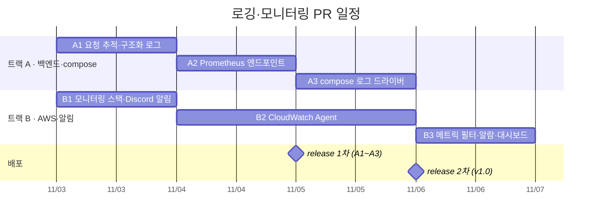

# 백엔드 로깅·모니터링 구현 계획 (2026년 11월)

> 목표: 11/6(금) v1.0 배포까지 백엔드 로그와 지표를 CloudWatch 에 모으고, 장애를 Discord 로 알린다.
> 2명이 트랙 A(백엔드·compose)와 트랙 B(AWS 리소스·알림)로 나눠 진행한다. 코드는 에이전트가 쓰고 사람은 리뷰와 merge 를 맡는다.
> 이 문서는 계획이다. 구현이 끝난 운영 절차는 각 PR 이 `docs/deployment.md` 에 옮겨 적는다.

## 한눈에 보기

| 항목 | 내용 |
| --- | --- |
| 범위 | 백엔드 컨테이너의 로그와 지표, EC2 호스트의 CPU·메모리·디스크. AI·웹·DB 컨테이너는 로그 회전만 건다. |
| 로그 | Docker `awslogs` 드라이버로 CloudWatch Logs `/ktc4/backend` 에 보낸다. traceId 로 Logs Insights 에서 찾는다. |
| 지표 | 백엔드가 `/actuator/prometheus` 로 내놓고, EC2 에 설치한 CloudWatch Agent 가 긁어 CloudWatch 메트릭으로 바꾼다. 같은 Agent 가 메모리·디스크도 보낸다. Prometheus 서버는 띄우지 않는다. |
| 알림 | CloudWatch 알람이 Lambda 를 직접 호출하고, Lambda 가 Discord 웹훅으로 보낸다. SNS 는 쓰지 않는다. |
| AWS 리소스 관리 | 로그 그룹·메트릭 필터·알람·대시보드·Lambda 를 CloudFormation 템플릿 하나(`deploy/monitoring/`)로 묶어 SSO 로 손으로 배포한다. |
| PR 수 | 트랙 A 3개, 트랙 B 3개. |
| 비용 | 무료 한도 안을 목표로 한다. 커스텀 지표 10개, 알람 10개, 대시보드 3개, 로그 월 5GB. 커스텀 지표는 [지표와 알람](#지표와-알람) 기준 7개다. |

### 일정

## 왜 이렇게 정했나

- **CloudWatch 를 쓴다.**
  - 2026-11-02 에 `ktc-team` SSO 로 확인했다. EC2 역할 `ktc-ec2-ssm-role` 에 `CloudWatchAgentServerPolicy` 가 붙어 있다.
  - 서울 리전에서 Logs·지표·알람 권한을 시뮬레이션하면 allowed 다.
  - 인프라 매니저에게 요청할 게 없고, 데이터가 AWS 계정 밖으로 나가지 않는다.
  - 조직 SCP 가 서울 리전 밖을 막으므로 CLI 는 항상 `--region ap-northeast-2` 로 쓴다.
- **Prometheus·Grafana 를 서버에 올리지 않는다.**
  - EC2 메모리는 4GB 인데 컨테이너 `mem_limit` 합이 약 3.1GB 다.
  - 서버에 같이 올리면 장애가 날 때 모니터링도 같이 죽는다.
  - 앱 내부 지표만 필요하므로 Prometheus 형식 엔드포인트만 열고, 수집은 CloudWatch Agent 가 맡는다.
- **Grafana Cloud 는 쓰지 않는다.** 검토는 했다. 대시보드와 Discord 알림은 더 편하다. 하지만 외부 SaaS 계정을 하나 더 관리해야 하고, 무료 대시보드 사용자가 월 3명이고, 로그를 보내려면 `docker.sock` 을 마운트해야 해서 뺐다.
- **알람이 Lambda 를 직접 부른다.** Discord 는 SNS 구독 대상이 아니라 어차피 Lambda 가 필요하다. SNS 를 빼면 리소스가 하나 줄어든다.
- **Lambda 코드는 레포에 둔다.** EventBridge API Destination 은 코드 없이 되지만, 메시지 모양을 다듬기 어렵고 실제로 울려 보기 전에는 검증할 수 없다. Lambda 는 코드가 레포에 있어 단위 테스트를 할 수 있다.
- **관리 포트를 따로 열지 않는다(제안).**
  - 처음에는 `management.server.port` 를 8081 로 나누려 했다.
  - 그러면 compose healthcheck(`localhost:8080/actuator/health`)와 `/actuator/health` 를 부르는 통합 테스트 2개를 같이 고쳐야 한다.
  - Caddy 는 `/api/v1/*` 만 백엔드로 넘기고 보안 그룹은 8080 을 막는다. 그래서 8080 을 그대로 쓰고 compose 에서 `127.0.0.1:8080` 으로만 호스트에 연다.
- **운영 로그를 JSON 으로 바꾼다(제안).**
  - Spring Boot 3.5 내장 구조화 로그(`logging.structured.format.console`)를 쓰고, 의존성은 늘지 않는다.
  - 메트릭 필터를 `{ $.status >= 500 }` 처럼 필드로 걸 수 있어, 문자열 일치보다 덜 깨진다.
  - Logs Insights 가 traceId·runId 를 필드로 바로 읽는다.
  - 로컬은 사람이 읽기 쉽게 지금처럼 텍스트로 둔다.

## 트랙 사이 계약

두 트랙이 동시에 진행하려면 아래 값을 먼저 고정해야 한다. 바꿀 때는 이 표를 먼저 고치고 상대 트랙에 알린다.

| 항목 | 값 | 만드는 쪽 | 쓰는 쪽 |
| --- | --- | --- | --- |
| 로그 그룹 | `/ktc4/backend`, 보존 14일(제안) | B1 (CloudFormation) | A3 (compose `awslogs-group`) |
| 로그 그룹 자동 생성 | 하지 않음(`awslogs-create-group: "false"`). 자동으로 만든 그룹은 보존 기간이 무기한이다. | B1 | A3 |
| 로그 형식 | JSON(Spring Boot `logstash` 형식). MDC 키 `traceId`, 판정 워커는 `runId`. 정확한 필드 이름은 A1 PR 본문의 실제 로그 예시가 기준이다. | A1 | B3 (메트릭 필터) |
| 요청 로그 | 요청마다 한 줄. 필드는 `method`, `path`(쿼리스트링 제외), `status`, `durationMs`, 알 수 있으면 `userId`. 본문과 거래 내용은 남기지 않는다. | A1 | B3 |
| 기동 로그 | Spring 기본 `Started BackendApplication in ...` 를 그대로 둔다. 재시작 알람이 이 문구로 센다. | A1 (바꾸지 않을 것) | B3 |
| 지표 엔드포인트 | `http://127.0.0.1:8080/actuator/prometheus` (호스트에서만 접근) | A2 | B2 |
| 수집할 앱 지표 | 아래 [지표와 알람](#지표와-알람)의 Prometheus 이름. 실제 이름은 A2 PR 본문의 출력이 기준이다. | A2 | B2 |
| Discord 웹훅 | `TEAM_DISCORD_WEBHOOK` 와 같은 웹훅에 장애 알림 스레드 ID 를 붙인 URL. CloudFormation `NoEcho` 파라미터로 넣는다. | B1 | — |

### 순서가 꼭 지켜져야 하는 곳

1. **B1 스택 배포가 A3 의 release 보다 먼저다.** `awslogs` 드라이버는 로그 그룹이 없으면 컨테이너를 띄우지 못한다. A3 를 develop 에 merge 하는 건 언제든 되지만, release 로 올리기 전에 서울 리전에 `/ktc4/backend` 가 있는지 확인한다.
2. **A1 의 로그 예시가 B3 의 메트릭 필터보다 먼저다.** B3 는 A1 PR 본문의 실제 JSON 한 줄로 `aws logs test-metric-filter` 를 돌려 필터를 확정한다.
3. **A2 가 release 된 뒤에 B2 의 Prometheus 수집을 운영에서 확인한다.** B2 의 메모리·디스크 수집은 A 와 상관없이 먼저 확인할 수 있다.
4. **`deploy/compose.yaml` 은 트랙 A 만 고친다.** A2(포트)와 A3(로그 드라이버)를 차례로 진행하므로 충돌하지 않는다. 트랙 B 는 `deploy/monitoring/`·`deploy/cloudwatch-agent/` 만 만든다.
5. **`docs/deployment.md` 는 양쪽이 고친다.** A 는 "로그" 절, B 는 "모니터링" 절에만 쓴다. 절 제목은 B1 이 먼저 만든다.

## 지표와 알람

임계값은 제안이다. 트래픽이 적어서 5xx 는 한 건이어도 받는다.

| 알람 | 출처 | 조건(제안) | 커스텀 지표 |
| --- | --- | --- | --- |
| HTTP 5xx | 로그 메트릭 필터(요청 로그 `status >= 500`) | 5분에 1건 이상 | 1 |
| 백엔드 재시작 | 로그 메트릭 필터(`Started BackendApplication`) | 1건 이상. 배포할 때도 울린다. | 1 |
| CPU | EC2 기본 `CPUUtilization` | 80% 이상이 5분 단위 2번 연속 | 0 |
| 서버 상태 | EC2 기본 `StatusCheckFailed` | 1 이상 | 0 |
| 메모리 | Agent `mem_used_percent` | 90% 이상 5분 | 1 |
| 디스크 | Agent `disk_used_percent` (`/` 만) | 80% 이상 | 1 |

대시보드에만 두고 알람은 걸지 않는 앱 지표(Prometheus 이름, A2 에서 확인):

| 지표 | Prometheus 이름(예상) | 커스텀 지표 |
| --- | --- | --- |
| Hikari 대기 커넥션 | `hikaricp_connections_pending` | 1 |
| JVM 힙 사용량 | `jvm_memory_used_bytes{area="heap"}` 합 | 1 |
| 판정 실행 풀 대기열 | `executor_queued_tasks{name="judgmentRunExecutor"}` | 1 |

- 위 셋은 모두 gauge 다. Prometheus counter 를 CloudWatch 로 옮기는 변환은 확인하지 않았다. 그래서 건수(5xx)는 로그 메트릭 필터로 센다.
- 지표 하나가 차원 조합마다 따로 과금된다. Agent 의 `metric_declaration` 에서 `uri` 같은 라벨은 차원으로 넣지 않는다.

## 트랙 A · 백엔드·compose

### A1 요청 추적·구조화 로그 (11/3)

- 요청마다 traceId 를 만들어 MDC 와 응답 헤더 `X-Trace-Id` 에 넣는 필터를 둔다.
- `ApiExceptionHandler` 는 새 UUID 대신 그 traceId 를 에러 본문에 쓴다.
  - 지금은 500 응답의 `traceId` 가 로그 어디에도 없어 찾을 수 없다.
- 같은 필터가 요청이 끝날 때 요청 로그를 한 줄 남긴다([계약](#트랙-사이-계약)의 필드).
- 판정 run 워커가 run 을 시작할 때 MDC 에 `runId` 를 넣고, 끝나면 지운다.
- 운영 프로필은 JSON 구조화 로그, `application-local.yml` 은 텍스트 로그.
- 검증
  - MockMvc: 응답 헤더와 에러 본문의 traceId 가 같다.
  - `OutputCaptureExtension`: 그 traceId 가 에러 로그와 요청 로그에 찍힌다.
  - `./gradlew -p backend check` 통과.
- PR 본문에 실제 JSON 로그 예시 3줄을 붙인다(정상 요청, 500 요청, 기동). B3 가 이걸로 필터를 만든다.

### A2 Prometheus 엔드포인트 (11/4)

- `micrometer-registry-prometheus` 를 추가하고 `management.endpoints.web.exposure.include` 에 `prometheus` 를 더한다.
- `deploy/compose.yaml` 의 backend 에 `ports: ["127.0.0.1:8080:8080"]` 를 둔다. 호스트의 Agent 만 접근한다.
- 확인할 것
  - `judgmentRunExecutor` 의 executor 지표가 자동으로 나오는지.
  - 안 나오면 이 PR 에서 등록한다.
- 검증
  - 통합 테스트: `/actuator/prometheus` 가 200 이고, 위 지표 이름들이 들어 있다.
  - 로컬에서 출력 줄 수로 시계열 수를 잰다.
- PR 본문에 [지표와 알람](#지표와-알람)의 실제 이름과 라벨을 적는다. B2 가 이걸로 수집 설정을 쓴다.

### A3 compose 로그 드라이버 (11/5)

- backend: `logging.driver: awslogs`
  - `awslogs-region: ap-northeast-2`, `awslogs-group: /ktc4/backend`, `awslogs-create-group: "false"`
  - `mode: non-blocking` 으로 둔다. CloudWatch 가 느려도 앱이 멈추지 않게 하기 위해서다.
- 나머지 서비스: `json-file` 에 `max-size: 10m`, `max-file: "5"`.
- 자격 증명
  - Docker 데몬이 호스트에서 인스턴스 역할로 보내므로 컨테이너에 자격 증명이 필요 없다.
  - EC2 의 IMDS hop limit 은 1 이라 컨테이너 안에서는 인스턴스 역할을 못 쓴다. 이 방식은 그 제약에 걸리지 않는다.
- 서버에서 `docker logs` 는 dual logging 으로 그대로 된다. 운영에서 확인한다.
- `docs/deployment.md` 에 "로그" 절을 쓴다: Logs Insights 에서 traceId 로 찾는 쿼리, 보존 기간, 남은 로그 확인 방법.
- 검증
  - `docker compose -f deploy/compose.yaml config` 로 문법을 본다.
  - release 뒤 Logs Insights 에서 A1 의 traceId 로 요청 하나를 찾는다.
- **release 조건:** B1 스택이 배포돼 로그 그룹이 있어야 한다.

## 트랙 B · AWS 리소스·알림

### B1 모니터링 스택·Discord 알림 (11/3)

- `deploy/monitoring/template.yaml` (CloudFormation)
  - 로그 그룹 `/ktc4/backend`(보존 14일).
  - Lambda(Python 3.12, 표준 라이브러리만)와 그 실행 역할.
  - 알람이 Lambda 를 부를 수 있게 `lambda.alarms.cloudwatch.amazonaws.com` 에 호출 권한을 준다.
  - 먼저 EC2 알람 2개(CPU, 상태 검사)를 넣어 전체 경로를 확인한다.
- `deploy/monitoring/alarm_to_discord.py`
  - 알람 이벤트를 한국어 메시지로 바꿔 웹훅으로 보낸다: 알람 이름, 상태(ALARM·OK), 이유, 콘솔 링크.
  - 웹훅 URL 은 환경 변수로 받는다.
- 단위 테스트(`unittest`): 알람 이벤트 예시를 넣으면 기대한 Discord 본문이 나온다. 네트워크 호출은 함수 인자로 바꿔 끼운다.
- `docs/deployment.md` 에 "모니터링" 절을 만들고 스택 배포 명령을 쓴다.
- 검증
  - `aws cloudformation validate-template`, 스택 배포.
  - `aws cloudwatch set-alarm-state` 로 CPU 알람을 ALARM 으로 바꿔 Discord 에 실제로 오는지 본다.
- 확인하지 못한 것: SSO 역할의 CloudFormation·Lambda·IAM 권한은 시뮬레이션만 했다. 실제 배포에서 막히면 CLI 스크립트로 바꾼다.

### B2 CloudWatch Agent (11/4~11/5)

- `deploy/cloudwatch-agent/` 에 Agent 설정과 Prometheus 수집 설정을 둔다.
  - 메모리: `mem_used_percent`.
  - 디스크: `disk_used_percent`, `/` 만 수집하고 장치·파일시스템 차원은 뺀다.
  - Prometheus: `127.0.0.1:8080/actuator/prometheus` 를 60초마다 긁는다. [지표와 알람](#지표와-알람)의 gauge 3개만 `metric_declaration` 으로 내보낸다.
  - 네임스페이스는 B 안에서 정한다(B3 만 쓴다).
- 설치 절차(패키지 설치, `amazon-cloudwatch-agent-ctl -a fetch-config`)를 `docs/deployment.md` 에 쓰고, 운영 EC2 에 한 번 설치한다.
- 검증
  - 메모리·디스크 지표가 콘솔에 보인다(A 와 무관, 11/4).
  - A2 release 뒤 앱 gauge 3개가 보인다(11/5).
  - `systemctl status amazon-cloudwatch-agent` 로 Agent 메모리 사용량을 재서 문서에 남긴다.

### B3 메트릭 필터·알람·대시보드 (11/6)

- B1 템플릿에 다음을 더한다.
  - 메트릭 필터 2개: 5xx, 재시작.
  - 알람 4개: 5xx, 재시작, 메모리, 디스크.
  - 대시보드 1개: CPU·메모리·디스크, 5xx·재시작 건수, 앱 gauge 3개.
- 검증
  - A1 로그 예시로 `aws logs test-metric-filter` 를 돌려 필터를 확인한다.
  - 알람마다 `set-alarm-state` 로 Discord 도착을 본다.
  - `aws cloudwatch list-metrics` 로 커스텀 지표 수가 10개 안인지 확인한다.

## 정할 것

아래는 제안값으로 진행하고, 바꾸려면 해당 PR 리뷰에서 정한다.

| 항목 | 제안 |
| --- | --- |
| 로그 보존 | 14일 |
| 임계값 | [지표와 알람](#지표와-알람) 표 |
| 배포 재시작 알림 | 받는다. 배포가 끝났다는 신호로도 쓴다. |
| Discord 스레드 | PR 알림·코퍼스 동기화와 다른 장애 알림 스레드를 새로 만든다. |

## 범위 밖

- AI 서버·웹(Caddy) 로그를 CloudWatch 로 보내기. 지금은 회전만 건다.
- 백엔드가 멈췄지만 재시작하지 않는 경우(응답 없음) 감지. 외부 상태 검사(Route 53 health check, Synthetics)가 필요하다.
- 분산 추적, Prometheus 서버, Grafana.
